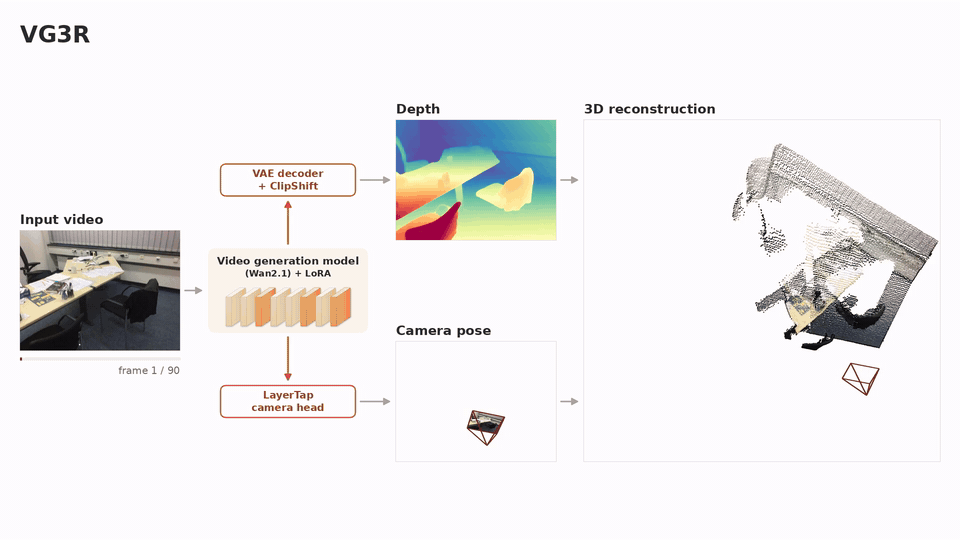
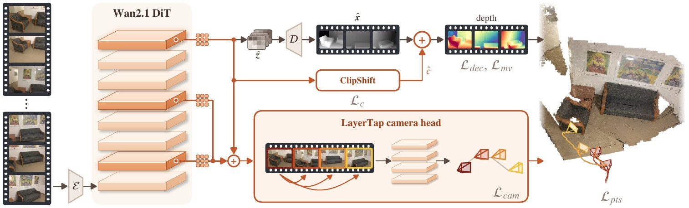
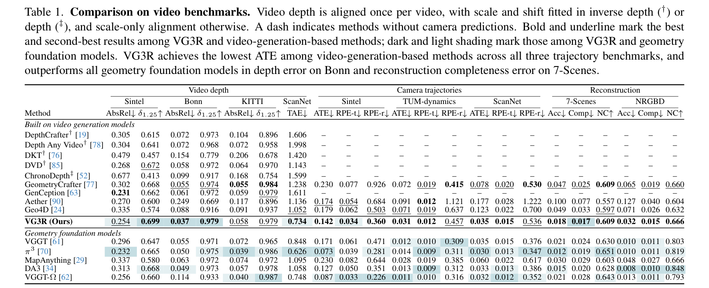
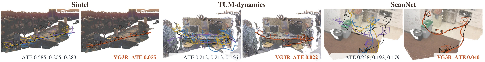

<div align="center">

# VG3R: Video Generation Model for Feed-Forward 3D Reconstruction

**Jingong Chen**<sup>1,3†*</sup> · [**Qingwen Zhang**](https://kin-zhang.github.io/)<sup>2†*</sup> · [**Linlian Jiang**](https://linlianjiang.github.io/)<sup>4,5</sup> · [**Xinxin Zuo**](https://sites.google.com/site/xinxinzuohome/)<sup>4</sup> · [**Yang Wang**](https://kywang.github.io/)<sup>4,5</sup> · [**Chulwoo Pack**](https://chulwoopack.com/)<sup>1</sup> · [**Kyle Gao**](https://www.aalto.fi/en/people/kyle-gao)<sup>3</sup> · [**Patric Jensfelt**](https://www.kth.se/profile/patric)<sup>2‡</sup> · [**Kwanghee Won**](https://www.sdstate.edu/directory/kwanghee-won)<sup>1‡*</sup>

<sup>1</sup>South Dakota State University &nbsp; <sup>2</sup>KTH Royal Institute of Technology &nbsp; <sup>3</sup>Aalto University<br>
<sup>4</sup>Concordia University &nbsp; <sup>5</sup>Mila – Quebec AI Institute<br>
<sup>†</sup>Equal contribution &nbsp; <sup>‡</sup>Equal advising &nbsp; <sup>*</sup>Corresponding author

<a href="https://kth-rpl.github.io/VG3R/"></a> <a href="https://arxiv.org/abs/2611.28520"></a> <a href="https://huggingface.co/Jingong/VG3R"></a> <a href="LICENSE"></a> <a href="#license"></a>



</div>

**VG3R** turns a pretrained video generation model into a feed-forward 3D reconstruction model. From a video, it predicts the depth
and the camera of every frame and a point cloud of the scene, without iterative denoising.

## News

- **2026-11-24** · Inference code, model weights and demos are released.

## Contents

[Highlights](#highlights) · [Installation](#installation) · [Weights](#weights) · [Quick start](#quick-start) · [Demos](#demos) · [Model](#model) · [Results](#results) · [Evaluation](#evaluation) · [Limitations](#limitations) · [Citation](#citation) · [License](#license)

## Highlights

- **Depth and cameras from a video generation model.** Video depth, camera poses, intrinsics and point clouds come from one network,
  without test-time optimization.
- **Videos of any length.** A video of up to 37 frames (the length of the training clips) is processed at once. A longer video is also
  processed in overlapping windows of 37 frames with a stride of 24, whose depth and cameras are chained over the shared frames.
- **Fast.** 74 to 84 ms per frame on one NVIDIA GH200 for depth and cameras together (Table 2 of the paper).

<p align="center"></p>

The backbone is the diffusion transformer (DiT) of
Wan2.1-T2V-1.3B with the LoRA of DVD, a deterministic video depth model, fine-tuned by us. The DiT maps the latent of the video to the
latent of an affine-invariant inverse depth video, which the video VAE decodes. Two heads read the tokens of the DiT:

- **ClipShift** predicts one shift per clip, which turns the decoded inverse depth into depth up to a single scale per video;
- **LayerTap** predicts the camera of every frame (rotation, translation and field of view) from the final tokens and the outputs
  of two intermediate blocks of the DiT.

## Installation

```bash
git clone https://github.com/KTH-RPL/VG3R.git && cd VG3R
conda create -n vg3r python=3.11 -y && conda activate vg3r
pip install torch==2.11.0 torchvision==0.26.0   # a CUDA build of PyTorch (the paper used CUDA 12.8)
pip install -e .              # the vg3r package (requirements.txt lists the versions of the paper's results)
pip install -e ".[demo]"      # optional: the Gradio demo and the GLB export
```

A GPU with bfloat16 support is needed (all results of the paper were computed on NVIDIA GH200 GPUs).

## Weights

Every script loads the weights from a local folder, `weights/` by default:

```
weights/
├── Wan2.1-T2V-1.3B/
│   ├── diffusion_pytorch_model.safetensors     Wan2.1-T2V-1.3B (DiT)
│   └── Wan2.1_VAE.pth                          Wan2.1-T2V-1.3B (VAE)
├── DVD/
│   └── dvd_1.1.safetensors                     DVD v1.1
└── vg3r.safetensors                            VG3R: our LoRA and heads
```

```bash
hf download Jingong/VG3R vg3r.safetensors --local-dir weights
hf download Wan-AI/Wan2.1-T2V-1.3B diffusion_pytorch_model.safetensors Wan2.1_VAE.pth \
    --revision 37ec512624d61f7aa208f7ea8140a131f93afc9a --local-dir weights/Wan2.1-T2V-1.3B
hf download FayeHongfeiZhang/DVD dvd_1.1.safetensors \
    --revision 769534dec2d77f8da3667719568fbe57fe69cd9b --local-dir weights/DVD
```

SHA-256 of the files used for the paper: `vg3r.safetensors` ebd03161ad0f6a083148f93b9075ff664ffadef5b7a75d3bb78b5ddc1959a482,
`diffusion_pytorch_model.safetensors` 96b6b242ca1c2f24e9d02cd6596066fab6d310e2d7538f33ae267cb18d957e8f,
`Wan2.1_VAE.pth` 38071ab59bd94681c686fa51d75a1968f64e470262043be31f7a094e442fd981,
`dvd_1.1.safetensors` 63079861484dfd6397a04f6327a0e20bbcee95ff1440cb7e61a83be2ecc6d854.

## Quick start

```python
from vg3r import VG3R, predict
from vg3r.io import read_frames
from vg3r.export import save_predictions

model = VG3R.from_pretrained("weights", "cuda")
frames = read_frames("examples/tum_walking_xyz/frames")    # uint8 (N, H, W, 3), RGB; a video file works too
pred = predict(model, frames)

pred["depth"]    # (N, h, w)      depth up to one scale per video; the median depth of frame 0 is 1
pred["c2w"]      # (N, 4, 4)      camera-to-world, OpenCV axes, in the frame of the first camera
pred["K"]        # (N, 3, 3)      pinhole intrinsics at (h, w)
pred["points"]   # (N, h, w, 3)   the depth of every frame back-projected into the world frame

save_predictions("outputs/tum_walking_xyz", pred, frames)   # points.ply, cameras.json, depth.npz, depth.mp4, scene.glb
```

The frames are resized to about 288 × 512 pixels (aspect ratio kept, sides multiples of 16), so `(h, w)` is (336, 448) for a 640 × 480
video. Depth and camera translations share one unit per video.

## Demos

**Command line.** Two example videos ship with the code:

```bash
# two people walk through an office (TUM RGB-D, 90 frames)
python demo.py --video examples/tum_walking_xyz/frames --out outputs/tum_walking_xyz

# a drive along a city street (KITTI, 77 frames)
python demo.py --video examples/kitti_0926_0002/frames --out outputs/kitti_0926_0002

# your own video: every second frame, at most 200 frames
python demo.py --video my_video.mp4 --stride 2 --max-frames 200
```

Each run writes `points.ply` (the points of all frames, without the points at depth discontinuities), `cameras.json` (camera-to-world
matrices and intrinsics), `depth.npz` (depth maps, intrinsics and cameras), `depth.mp4` (the input and its inverse depth side by side)
and `scene.glb` (points and cameras, for any glTF viewer).

**Interactive.** `python demo_gradio.py` opens a browser app: upload a video or pick an example, then inspect the depth video, the point
cloud with the cameras, and download the outputs.

## Model

| Model | Parameters | Input | Weights |
|:---|:---|:---|:---|
| VG3R | DiT 1.3 B, LoRA 0.70 B (rank 512), heads 72 M, and the Wan2.1 VAE | a video of any length, frames resized to about 288 × 512 pixels | [🤗 Jingong/VG3R](https://huggingface.co/Jingong/VG3R) |

VG3R is trained on 11 public datasets: ScanNet++, TartanAir V2, Matterport3D, ScanNet, PointOdyssey, Dynamic Replica, Spring, Virtual
KITTI 2, DL3DV, Waymo and RealEstate10K. The LoRA is initialized from DVD v1.1 and trained together with the heads, for about 40 hours
on 128 NVIDIA GH200 GPUs. No evaluation sequence is part of the training data.

## Results

All numbers are from the paper. Table 1 compares VG3R with the methods built on video generation models and with geometry foundation
models on video depth, camera trajectories and reconstruction.

<p align="center"></p>

<p align="center"></p>

Camera trajectories over the ground-truth point cloud, with the ground-truth cameras in black (Fig. 6 of the paper). Left of each
pair: GeometryCrafter (blue), Aether (purple) and Geo4D (yellow), with ATE reported in this order. Right: VG3R. The
[project page](https://kth-rpl.github.io/VG3R/) shows the reconstructions as interactive point clouds, the video depth as videos and
the trajectories in 3D.

## Evaluation

`eval/` reproduces the numbers of VG3R in Table 1 of the paper (video depth, temporal consistency, camera trajectories and
reconstruction from video) from the original datasets, with the evaluation code of π³ and the TAE code of Video Depth Anything; see
[eval/README.md](eval/README.md). `tests/` checks the geometry code and, with the weights and a GPU, the inference (`pytest tests`).

## Configuration

`configs/vg3r.json` lists the settings of the final model: the architecture, the inference settings with which
every result of the paper was computed (input size, windows, precision, attention; NVIDIA GH200) and the training setup. The code
applies them as listed. The evaluation protocols of the benchmarks are described in Appendix C of the paper.

## Limitations

- **Scale.** Depth and camera translations are known up to one scale per video.
- **Resolution.** The network sees frames of about 288 × 512 pixels; the depth maps and the point clouds have this resolution.
- **Long videos.** Windows of 37 frames are chained over their overlaps, so errors can accumulate over very long videos.
- **Moving objects.** Depth and cameras are predicted for videos with moving objects, but the point cloud of a video accumulates the
  moving objects of all frames.
- **Intrinsics.** One pinhole camera per video, with the principal point at the image center.

## Citation

```bibtex
@article{chen2026vg3r,
  title   = {{VG3R}: Video Generation Model for Feed-Forward {3D} Reconstruction},
  author  = {Chen, Jingong and Zhang, Qingwen and Jiang, Linlian and
             Zuo, Xinxin and Wang, Yang and Pack, Chulwoo and
             Gao, Kyle and Jensfelt, Patric and Won, Kwanghee},
  journal = {arXiv preprint arXiv:2611.28520},
  year    = {2026}
}
```

## License

The code in this repository is released under the MIT License (`LICENSE`), except for the third-party code it includes:
`vg3r/_dvd/` (DVD and DiffSynth-Studio) is under the Apache License 2.0 and `vg3r/_vggt/` (VGGT's camera head) under the VGGT
License. The evaluation code in `eval/third_party/` keeps its licenses: the files of the evaluation code of π³
(`eval/third_party/pi3_eval/`) are under its license for non-commercial purposes, and the TAE code of Video Depth Anything
(`eval/third_party/vda/`) is under the Apache License 2.0. The VG3R weights, fine-tuned from the DVD weights (CC BY-NC 4.0),
are released under CC BY-NC 4.0 for non-commercial research. The example frames keep their dataset licenses; see
`THIRD_PARTY_NOTICES.md`.

## Acknowledgments

VG3R builds on the code and models of Wan2.1, DVD (which builds on DiffSynth-Studio) and VGGT, whose camera head LayerTap uses. The evaluation runs
the evaluation code of π³ and the TAE code of Video Depth Anything. The example videos come from the TUM RGB-D dataset and the KITTI dataset.
